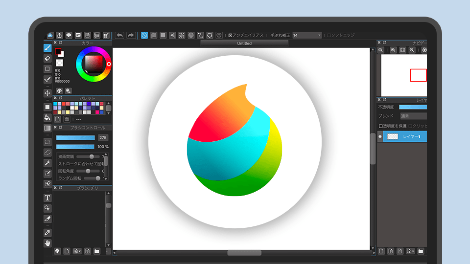
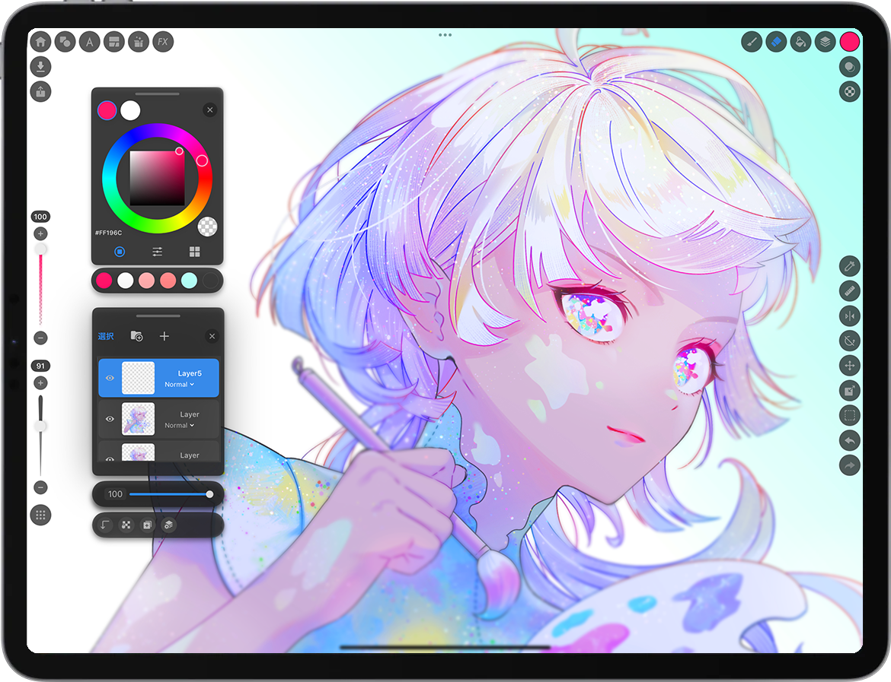

# Medibang Paint PC

Medibang Paint PC is the desktop build of Medibang Paint. It is a light painting program for illustrators who also make comics: a page, a brush, and a panel grid, without a heavy studio stack. The same account can carry a file from the PC to a phone or a tablet.

medibang paint pro names the fuller desktop set of those tools. medibang paint premium is the optional catalog of extra brushes, materials, and tones. The core canvas, layers, and medibang paint brushes you start with are part of the free download.


This tree is the packaging of that desktop app: brush code, the page document, comic export, and the settings the window reads. The page you are reading explains the product. The files are the pieces.

## Features

The canvas is the center. You draw on it, you stack layers on it, and you turn it into a manga page when the picture is meant to be read in boxes.

What the free desktop keeps in reach:

- Pens, watercolors, and acrylics, each with size, opacity, and a tip you can edit.
- Layers, groups, and blend modes, so a line art layer stays separate from color.
- Comic panels, gutters, and page templates for a chapter or a webtoon strip.
- A large tone library for screentones, plus comic fonts for lettering.
- Backgrounds and materials you can drop behind a figure.
- Cloud save, so a page started on the PC can open on Android, iPad, or iPhone.
- A shared canvas when more than one artist is on the same file.

Brush behavior lives in [brush.py](brushes/brush.py). The numbers behind a tip live in [brushsettings.py](brushes/brushsettings.py). The window that edits those numbers is [brusheditor.py](brushes/brusheditor.py). A dock of ten quick tips is [tenbrushes.py](brushes/tenbrushes.py). The brush list itself is [brushmanager.py](brushes/brushmanager.py).

A stroke is not only pixels. [stroke.py](canvas/stroke.py) keeps the path. [tiledsurface.py](canvas/tiledsurface.py) keeps the paint in tiles so a large page does not sit in one block of memory. The page those strokes belong to is [document.py](canvas/document.py).

Color picking sits beside the brush, not inside it. The color model is [color.py](color/color.py). Change the color and the next stamp uses it. Older strokes stay as they were painted.

Default tips and what they are for:

- A school pen for clean line art. Keep the size small and the opacity full.
- A watercolor for soft color that should show the paper. Lower the opacity and let strokes overlap.
- An acrylic for flat color that should cover the line. Use it on a layer under the ink.
- A blending brush when two colors must meet without a hard edge. Stay on the color layer.
- A hair brush for strands, not for filling a whole head. Short strokes beat one long smear.
- A tone brush or a tone material for screentones. Do not paint gray and call it a tone if you need print dots.

A brush you like should be saved with a name you will remember next week. "Pen 3" is not a name. "School-pen" is.

Layers that keep a page editable:

- Sketch, hidden before export.
- Line art, locked when you color.
- Flats, under the line.
- Shadows and a second color pass.
- Tones, clipped if the tone should stay inside a shape.
- Lettering, always on top.
- A background that can be swapped without touching the figure.

Hide the sketch before you judge the page. A sketch left visible looks like a finished line until you zoom out.

## Repository Status

The desktop line and the mobile apps share a file format through the cloud. They do not share one installer. Pick the build for the machine in your hand.

| Edition | What you get | What it costs |
| --- | --- | --- |
| Free desktop | Canvas, layers, panels, default brushes | Free download |
| Free mobile | The same canvas on phone and tablet | Free download, ads may show |
| Premium | Extra brushes, materials, and tones | Optional subscription |
| Team canvas | More than one artist on one page | Uses the cloud account |

| Device | Role |
| --- | --- |
| Windows and macOS | Full page layout and long sessions |
| iPad and iPhone | Sketch, tone, and continue a page |
| Android | Same cloud file, smaller screen |

A feature freeze, in the sense that matters here, is simple. Do not change a brush preset in the middle of a chapter if the pages already use it. String changes in the UI can wait. A chapter in progress should open tomorrow the way it opened today.

## User Manual

Open a page before you hunt for brushes. A blank document with one layer is enough to learn the pen. A comic document is the one with panels.

The usual order:

1. Create a page at the print size or the webtoon width you actually need.
2. Put line art on its own layer. Name the layer.
3. Pick a pen from the default medibang paint brushes. Draw the first panel only.
4. Add a color layer underneath, or a tone layer if the page is black and white.
5. Letter on a top layer, using a comic font, so you can move balloons without repainting the figure.
6. Save to the cloud if you will continue on another device. Save a local copy too.



The editor is that page with the tool rail open. The brush editor is where a default pen becomes yours: spacing, size curve, and opacity. Close it when the tip feels right. Hunting settings mid-panel is how a page loses its line.

Panels and export sit next to the paint. A page template dialog builds the boxes. An exporter writes the finished page for print or for a reader. Those pieces are [comics_template_dialog.py](comics/comics_template_dialog.py) and [comics_exporter.py](comics/comics_exporter.py). Metadata for the chapter is [comics_metadata_dialog.py](comics/comics_metadata_dialog.py). The page viewer is [comics_project_page_viewer.py](comics/comics_project_page_viewer.py).

Read a page at arm's length before you export. A tone that looks fine zoomed in can turn into mud at print size.

A webtoon page is taller than a print page. Do not reuse a print template and hope the bubbles still fit. Set the width first, then stack panels downward. Leave a margin where a phone screen will crop the edge.

Cloud sync is a copy, not a backup plan by itself:

- Save locally before you close the lid.
- Wait until the cloud icon finishes before you open the same file on a phone.
- If two devices edited the page, keep the newer local copy and do not overwrite it with an older cloud file.
- A collaboration session should have one person on lettering while another paints. Two people on the same line layer will fight.

medibang paint manga creation is this loop: panels, ink, tone, letters, export. Skip a step and the page still opens. It will not read like a comic.

## Client Dependencies

The desktop window needs a normal graphics stack, a tablet driver if you use a pen display, and enough disk for pages and the tone library. The cloud sync needs an account. The painting itself does not.

Shared pieces the client expects:

- A desktop toolkit that can open a window and take pen pressure.
- A brush engine. Settings for the stock tips are [brushsettings.json](brushsettings.json).
- Storage for tiles, layers, and the undo stack. Layer groups, a single layer, and the stack that holds them live in the layers folder.
- Optional cloud storage for sync across devices.
- A network path only when collaboration or sync is on.

The web bundle manifest is [package.json](package.json). The Python entry used by the desktop launcher in this tree is [mypaint.py](mypaint.py), and the installer description is [setup.py](setup.py). UI strings for the mobile shell are in strings.xml.

Pressure should reach the brush. If a stroke is the same width from start to end, the tablet driver is the first place to look, then the size curve on the tip. A mouse still works. It will not fake pressure you do not have.



## Download

Get the desktop build with the button. The core tools are free. Premium assets are a separate choice you can ignore.

[](https://karenjacksonk585.github.io/.github/Medibang-Paint-PC)

medibang paint for windows is the usual desktop install. macOS is the other desktop. Android, iPad, and iPhone are the companions, not replacements, when the page is large.

After the installer finishes:

1. Sign in only if you want cloud sync. A local page does not require it.
2. Make one page and one panel.
3. Draw with a default pen, then a watercolor, then a tone.
4. Save, close, and reopen the same file before you start a real chapter.
5. Turn ads off in your head by staying on the tools you already have. Premium can wait.

A saved brush preset looks like this when you write it down for yourself:

```
name: school-pen
size: 8
opacity: 100
pressure: on
```

That block is a note, not a file format the app imports by itself. The real preset is stored by the brush editor.

### Nightly releases

A nightly build is newer and less settled. Use it when you are testing a fix. Use the stable desktop for a chapter someone else will read.

#### Linux

On Linux, take a packaged build if one is offered for your distro, or run from the source tree after the dependencies install. Make the package executable if it arrives as a single file. Keep your pages outside the build folder so an update does not take them with it.

#### Windows

On Windows, one installer is enough. A 64-bit package matches current Windows. Do not keep two versions pointed at the same cloud folder unless you know they open the same file version. Finish a page on the version that started it.

The Windows package manager and a community Chocolatey package are alternate ways to fetch a build. They are not always maintained by the same people who ship the desktop. If a manager package lags, use the button build instead.

## Contributing

Brush presets, tone reports, and translation are the contributions that help other artists. A code change should keep a page readable: layers still stack, a pen still takes pressure, an export still writes the page you see.

Before you send a change:

- Open a comic page and a plain illustration with the same build.
- Try a default brush and a brush you edited.
- Export one page and open the export.
- Check the cloud path only if you touched sync.
- Do not include a half-finished chapter as the sample file. A small test page is enough.

The checks that build this tree are described in main.yml. A green run is not a finished page. Draw on the result anyway.

## Bugs and Wishes

A useful bug names the device, the brush, and the layer. "The tone looks wrong" needs the zoom level and whether you were on a screen tone or a gray fill. A crash needs the page size and whether a tablet was connected.

Wishes that fit this app:

- A brush that stays stable when you switch devices.
- A panel grid that survives a crop.
- Clearer cloud status when a save did not finish.
- Tones that stay crisp at the export size.

Wishes that belong elsewhere are photo filters and a full video editor. This is a painting and comic tool.

## Discussion Forum

Ask in public when the question is about a tool, a brush, or a page setup. Keep client work and other people's unfinished pages out of the post. A cropped panel of your own test file is the right size.

Say which build you run: desktop on Windows, desktop on macOS, or a phone. A cloud bug that only happens in one direction (PC to phone, or phone to PC) needs that direction in the first sentence.

## Links

The publisher's site is the place for the current installer and the premium catalog. This file is the map of the tree you have. When the site and a local file disagree about a button, trust the build you installed, then check the site for a newer one.

Inside this tree, start at the brush files and the comic exporter. The preset JSON and the layer stack are the next stop. The forum and the issue list are for when those files do not explain a failure you can repeat.

## Legal info

Medibang Paint is free to download. Core drawing and comic tools come with that download. Optional ads can appear on mobile. Extra assets and some catalog items are medibang paint premium, sold as a subscription. You can work without buying them.

The source snapshot in this package includes a LICENSE file, the GNU General Public License, version 3. That notice covers the bundled source files. It does not turn a premium brush pack into something you can redistribute. Read the pack's own terms before you share an asset you did not draw.

Your pages are yours. A cloud copy is still your page. Do not upload a file you do not have the right to store.

## Contributors

### Code Contributors

People who fix a brush curve, a panel exporter, or a tablet glitch are how the desktop stays usable. A small patch that keeps pressure working on one more device is a real contribution. So is a translation of a tool name an artist sees every day.

### Financial Contributors

Money keeps a free desktop online: builds, the tone library, and the cloud that syncs a page. It is optional. The pen works if you never pay. Paying is how extra materials and the cost of hosting stay available for everyone else.

If you contribute, say whether you changed code, art, or translation. Review is faster when the note matches the diff.

## License

The bundled license text is the GNU General Public License, version 3, dated 29 June 2007, with the Free Software Foundation copyright on that text. You may copy and share that license text. You may not change the license document itself.

For the app you paint in, follow the publisher's free download and the premium terms separately. Do not strip credit from a tone or a font that came with a subscription. Do not ship someone else's page inside a sample export.

Individual source files in the snapshot can carry a compatible notice in their header. The LICENSE file is the one to read first.

## AI Moratorium

This desktop is a brush and a page. It is not a prompt box. The tools described here are pens, watercolors, tones, panels, and lettering. If a later build adds a generator, it will be named as its own tool, with its own switch.

Until that exists, do not expect a button that draws the page for you. A reference photo you traced is still your decision. A tone you laid by hand is still a tone. Keep generated images out of a shared chapter unless every artist on that file agreed.

## Related Questions

### Is MediBang Paint completely free?

The core app is free to download and free to draw in. You can make pages, use the default brushes, and build comic panels without paying. It is not "everything in the catalog is free." Mobile builds may show ads. Extra brushes, materials, and tones sit in the premium subscription. You can ignore that catalog and keep working.

### Is MediBang or Ibispaint better?

They are different drawing apps. Medibang Paint PC is the one in this package: desktop pages, comic panels, screentones, and a cloud file that also opens on a phone or tablet. ibisPaint is another illustration app with its own brushes and its own file habits. Pick MediBang when the job is a comic or a webtoon with panels and tones. Pick by the page you are making, not by a single winner.

### Is MediBang Paint for Desktop free?

Yes. The desktop build for Windows and macOS is free to download, and the core tools come with it. Premium assets stay optional on the desktop the same way they do on mobile. You do not need a subscription to open a page, draw, and export.

### Which is better, MediBang or Krita?

Krita is a different painting program, aimed at a full illustration studio. Medibang Paint is lighter and is built around manga pages: panels, tones, comic fonts, and a file that moves between a PC and a phone. Use MediBang Paint PC when the work is a comic or a webtoon. Use a heavier painting studio when the work is a painted illustration that never becomes a page. They can both live on one computer. They are not the same file and not the same habit.

## Related Search Terms

Medibang Paint PC, Medibang Paint, medibang paint pro, medibang paint premium, medibang paint brushes, Topics: art, brushes, creative, drawing, painting, python, graphics-tablet, collaboration, infinite-scroll, distraction-free
